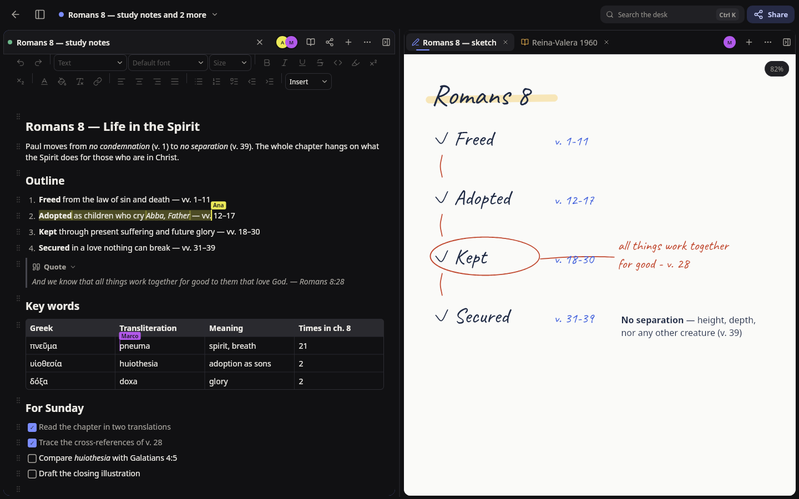
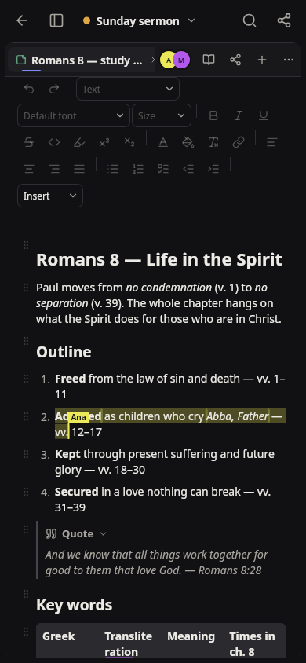
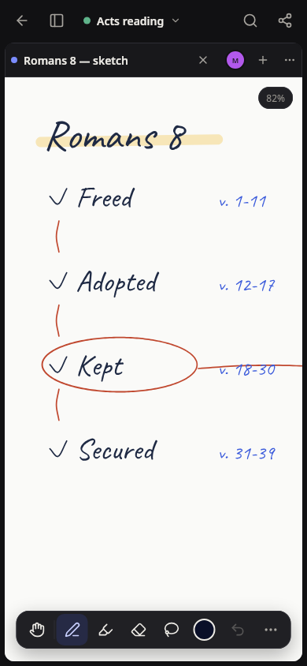
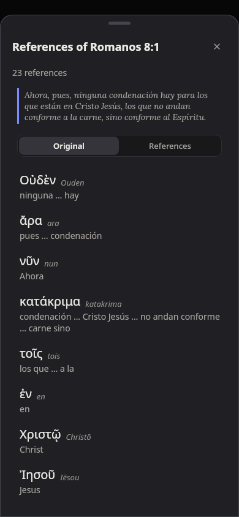
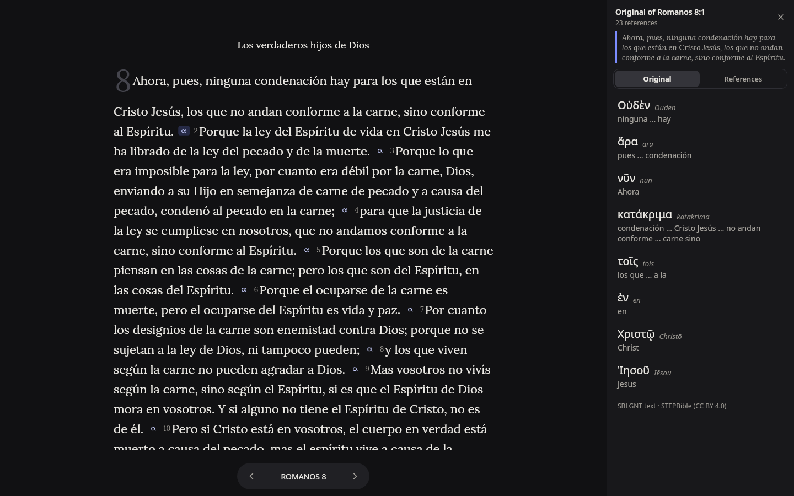
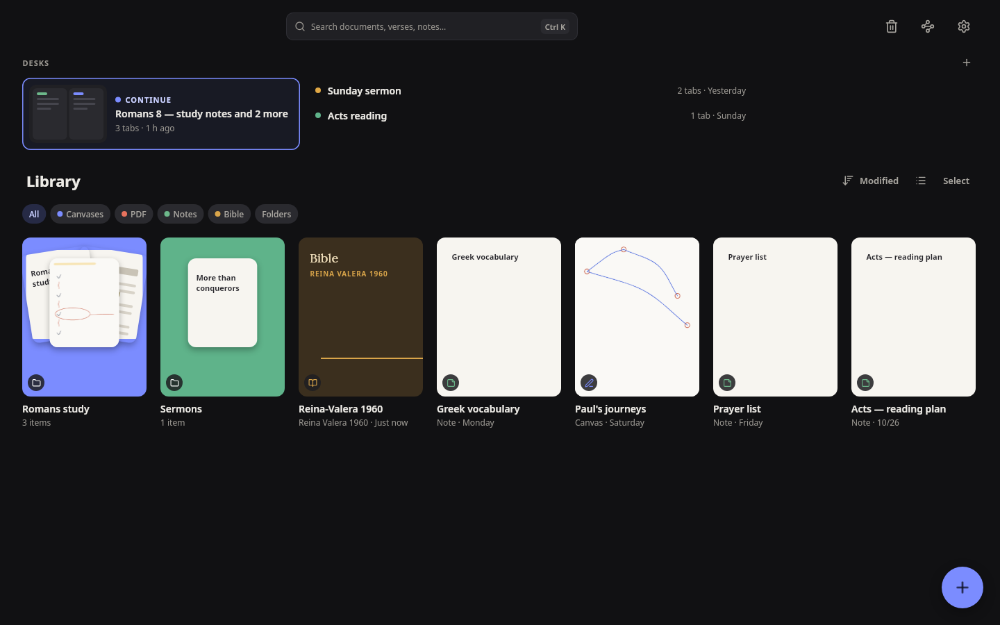
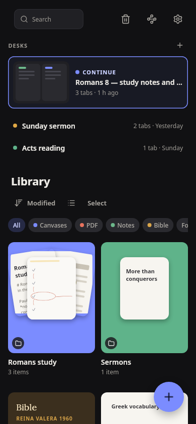

<p align="center">
  <picture>
    <source media="(prefers-color-scheme: dark)" srcset="assets/brand/svg/notinplus-horizontal-reversed.svg">
    
  </picture>
</p>

<p align="center">
  Handwriting, markdown notes, PDF annotation and Bible study in one app,<br>
  synced between your devices — on Android, Linux, macOS and Windows.
</p>

<p align="center">
  <a href="https://github.com/SergioRibera/notinplus/releases"></a>
  <a href="https://github.com/SergioRibera/notinplus/actions/workflows/ci.yml"></a>
  
</p>

> [!WARNING]
> NotIn Plus is in **alpha**. Expect rough edges, and keep a backup
> (Settings › Library › Export) of anything you can't lose: file formats
> and the sync protocol may still change between versions.

<p align="center">
  
</p>

<p align="center">
  
  
  
</p>

## Features

**Write and annotate**

- A canvas for pen or finger: palm rejection, a lasso to move, recolor or
  duplicate strokes, and text boxes and images you can move, scale and
  rotate.
- Markdown notes that edit like a word processor: tables with totals and
  computed columns, formulas, diagrams, images and collapsible blocks.
- PDFs with ink, bookmarks and a table of contents; replace the file
  without losing what you wrote on it.
- Export any document as PDF or image.

**Study the Bible**

- Several translations, with a catalog, search and background downloads.
- Search every verse with phrases, prefixes, `OR` and exclusions.
- Cross-references in a side panel (the **α** after a verse), and the
  Hebrew or Greek behind each verse.
- Quote verses into your notes as a reference or as text.

**Organize and connect**

- Notebooks, folders and covers on Home; desks that keep several
  documents open side by side.
- Links between documents, sections and PDF pages, and quotes that stay
  up to date.
- Search everything from anywhere with <kbd>Ctrl</kbd> <kbd>K</kbd>.

**Sync and share**

- Pair your devices on the same network and keep the library in step.
- Share a document, a notebook or a desk with other people: roles, entry
  approval and live editing with everyone's cursor.
- An optional relay server, [`notein-relay`](tools/notein-relay), links
  devices outside the local network. It stores and forwards sealed
  records it cannot read.

**Also**

- English and Spanish interface, six themes and any accent color.
- Third-party plugins.
- In-app notice when a new version is out.

<p align="center">
  
</p>

<p align="center">
  
  
</p>

## Install

Download the latest build from
[Releases](https://github.com/SergioRibera/notinplus/releases):

| Platform | Package |
|---|---|
| Android | `notinplus-*-android-universal.apk` (the `arm64-v8a` / `x86_64` APKs are smaller) |
| Linux | AppImage, `.deb`, `.rpm`, `.flatpak` or `.tar.gz` |
| macOS (Apple silicon) | `.dmg`, `.pkg` or the zipped `.app` — unsigned: right-click › Open the first time |
| Windows | `-setup.exe` (NSIS) or `.msi` |

With Nix:

```sh
nix run github:SergioRibera/notinplus
```

Prebuilt binaries are in the `cache.sergioribera.rs/main` binary cache
(the flake already points at it).

### Relay server

The release also ships `notein-relay` as a `.deb` / `.rpm` that installs
a systemd service (UDP 7720), a standalone `.tar.gz`, and a container:

```sh
docker run -p 7720:7720/udp -v relay:/data \
  ghcr.io/sergioribera/notein-relay:<version> \
  --port 7720 --data /data --advertise <public-host>
```

Then point the app at it in Settings › Devices › Server.

## Build from source

NotIn Plus is written in Rust with [Freya](https://github.com/marc2332/freya)
for the interface and [istmo](https://github.com/SergioRibera/istmo) for
the native side (Android, iOS) and the platform plugins.

```sh
nix develop          # toolchain, libraries and `just`
just run             # desktop app
just test            # every test
just build-android   # debug APK (Gradle drives cargo for every ABI)
just build-ios       # simulator build via xcodegen + xcodebuild
```

Release builds and bundles come from the flake:

```sh
nix build .#notinplus          # desktop app for the host
nix build .#bundles            # every package for the host
nix build .#windows-bundles    # Windows, cross-built from Linux
```

### Layout

| Path | What lives there |
|---|---|
| `src/` | The app shell: Home, desks, settings, sync, update checks |
| `crates/notein-*` | Library model, plugin SDK, sync, Bible, notes, handwriting, UI kit |
| `crates/freya-*` | Freya components: markdown editor, PDF, math, diagrams, canvas backgrounds |
| `tools/notein-relay` | The relay server |
| `android/`, `ios/` | Native projects (Gradle, xcodegen) |
| `assets/brand/` | Logo, icons and the brand guide |

### Releasing

`just release "" --execute` tags the current version;
`just release minor --execute` bumps it first. The `v*` tag builds every
package and publishes the GitHub release (see `release.toml` and
`.github/workflows/release.yml`).

## License

Licensed under either of [Apache License 2.0](LICENSE-APACHE) or
[MIT](LICENSE-MIT), at your option.
