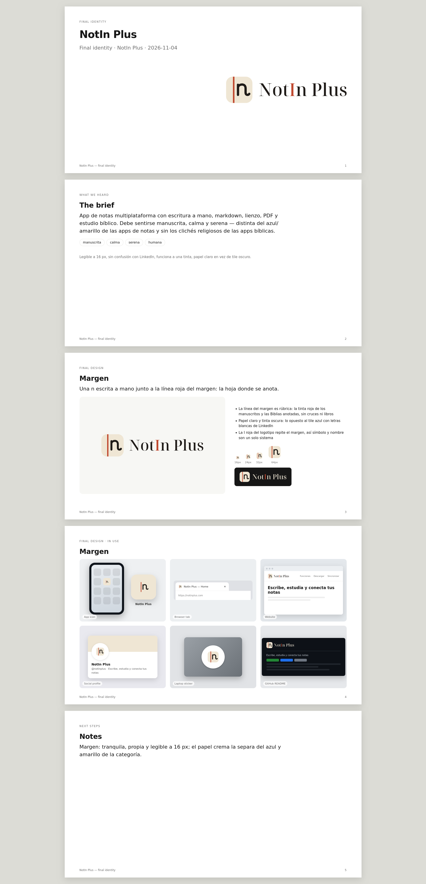

# NotIn Plus — marca

## Idea

Una **n escrita a mano junto a la línea roja del margen**: la hoja donde se anota.

- La línea del margen es *rúbrica*, la tinta roja con la que los manuscritos y las
  Biblias anotadas marcaban lo importante. Evoca estudio y reverencia sin cruces,
  libros abiertos ni palomas.
- La n es un trazo monolínea con remate curvo: escritura, no tipografía.
- En el logotipo, la **I** de NotIn va en rojo y repite el margen: símbolo y nombre
  son un mismo sistema.

Adjetivos del brief: manuscrita · calma · serena · humana.

## Análisis de competencia

| Grupo | Convención visual | Cómo nos separamos |
|---|---|---|
| Notas generalistas (Apple Notes, Google Keep) | Amarillo, libreta/hoja, bombilla | Papel crema y tinta, sin amarillo ni objetos dibujados |
| Notas con N (Notion, OneNote) | N mayúscula geométrica o en tile de color sólido | n minúscula, manuscrita, sobre papel |
| Escritura a mano (GoodNotes, Notability, Nebo, Noteshelf) | Azules/turquesas, lápiz o pluma | Ningún útil dibujado: la escritura es la propia letra |
| PKM (Obsidian, Logseq) | Morados, cristales, grafos | Calma y papel, no "tech" |
| Estudio bíblico (YouVersion, Logos, Blue Letter Bible) | Tile rojo/marrón con libro, cruz o L | El rojo es solo una línea fina; el campo es papel |
| Red profesional (LinkedIn) | Tile azul oscuro con "in" blanco | Tile claro, n oscura, sin punto de i, regla roja de borde a borde |

Las convenciones de los competidores son de memoria (la librería de referencia solo
tiene Google Keep, Todoist y LinkedIn). Antes de registrar la marca hay que verificarlas.
La prueba de estantería contra los logos disponibles está en `png/shelf-test.png`.

**Prueba de estantería, resultado:** a 16 y 24 px la marca se lee como "|n" sobre
papel y no se confunde con LinkedIn. Riesgo detectado: sobre fondos blancos o crema el
borde del tile casi desaparece (contraste papel/blanco 1,24:1). Se acepta porque la n y la
regla sostienen la forma (igual que el ícono blanco de Notion). En documentos sobre
blanco conviene usar el símbolo sin tile o el logotipo horizontal.

## Color

| Nombre | HEX | RGB | CMYK aprox. | Uso |
|---|---|---|---|---|
| Papel | `#EFE6D4` | 239 230 212 | 0 4 11 6 | Campo del ícono, fondos de marca |
| Tinta | `#1F1B18` | 31 27 24 | 0 13 23 88 | n, logotipo, texto |
| Rúbrica | `#C0482F` | 192 72 47 | 0 63 76 25 | Regla del margen, I del logotipo |

Pantone: buscar la equivalencia con un swatch físico (Rúbrica ≈ familia 7599/7621 C;
no verificado).

Contrastes (WCAG): tinta/papel 13,8:1 · rúbrica/papel 4,0:1 · rúbrica/blanco 5,0:1 ·
rúbrica/noche `#16181C` 3,6:1 · papel/noche 14,3:1. La rúbrica nunca se usa para texto
corrido; como elemento gráfico supera 3:1 en todos los fondos aprobados.

## Tipografía

- **Logotipo:** Noto Serif Display, peso 500, convertido a trazos. Contraste alto y
  serifas finas: tono sereno y editorial, que equilibra la n monolínea del símbolo.
  Licencia SIL OFL, que permite uso en logos.
- Los SVG finales no contienen texto vivo: no hace falta tener la fuente instalada.
- Texto de acompañamiento (web, material): Noto Serif / Noto Sans.

## Piezas

| Archivo (`svg/`) | Uso |
|---|---|
| `notinplus-horizontal.svg` | Logotipo principal (tile + nombre) |
| `notinplus-stacked.svg` | Espacios cuadrados: splash, portada, avatar grande |
| `notinplus-wordmark.svg` | Solo el nombre, cuando el ícono ya está presente |
| `notinplus-tile.svg` | Ícono con tile redondeado (web, documentación, escritorio: `png/notinplus-tile-1024.png` es la fuente de `[app.icon] desktop` y de `info.icon` en `flake.nix`) |
| `notinplus-tile-small.svg` | Corte para tamaños chicos, ≤ 32 px (favicon): trazos más gruesos, n más grande |
| `notinplus-app-icon.svg` | Ícono de app a sangre (iOS/Android aplican la máscara) |
| `notinplus-symbol.svg` | Símbolo sin tile: regla + n |
| `*-reversed.svg` | Versiones para fondos oscuros (n y nombre en papel) |
| `*-black.svg` / `*-white.svg` / `*-ink.svg` / `*-rubric.svg` | Una tinta (sellos, grabado, bordado) |

Otros:
- `web/`: favicon.ico (16/32/48), favicon.svg, PNG, apple-touch-icon, maskable, `site.webmanifest`, `head-snippet.html`.
- `android/`: capas del ícono adaptativo como vectores de Android (`ic_launcher_background/foreground/monochrome.xml`, las que usa la app vía `[app.icon.android]` en `istmo.toml`), sus SVG de referencia (lienzo de 108 dp, contenido dentro de la zona segura de 66 dp) y PNG heredados.
- `ios/`: AppIcon 1024.
- `png/`: rasters de los logotipos.

## Reglas de uso

- **Espacio libre:** alrededor de cualquier versión, como mínimo **x = ¼ del alto del
  tile** (52 px en un tile de 208).
- **Tamaños mínimos:** tile 16 px (usar `tile-small` hasta 32 px) · horizontal 24 px de
  alto · apilado 64 px de alto · logotipo solo 16 px de alto de mayúscula.
- **Fondos aprobados:** blanco, papel, noche `#16181C`/tinta (con las versiones
  `reversed`). Sobre fotos, solo el tile completo.
- **El tile conserva siempre el papel**, también en modo oscuro.

### No hacer

- Tile oscuro con n clara: vuelve la lectura de LinkedIn.
- Agregar un "+" suelto al símbolo; el "Plus" vive en el nombre.
- Cambiar la regla de rúbrica a otro color en la versión a color, o pintar la I de otro
  color que no sea rúbrica (o el mismo color del resto en una tinta).
- Inclinar, estirar, contornear, sombrear o poner degradados.
- Reescribir el nombre con otra tipografía o como "Notin Plus" / "Notein Plus".

## Regenerar

`source/src.py` genera las fuentes (trazos + texto vivo). Inkscape las convierte a
contornos (`object-stroke-to-path`, `--export-text-to-path`) y `source/fix.py` limpia los
archivos y fija los viewBox. `source/presentation-spec.json` construye
`presentation.html` con el script `presentation_board.py` de la skill logo-design.

## Pendiente

- Búsqueda profesional de marca registrada y búsqueda inversa de imágenes.
- Prueba en dispositivo de los íconos adaptativos y temáticos.
